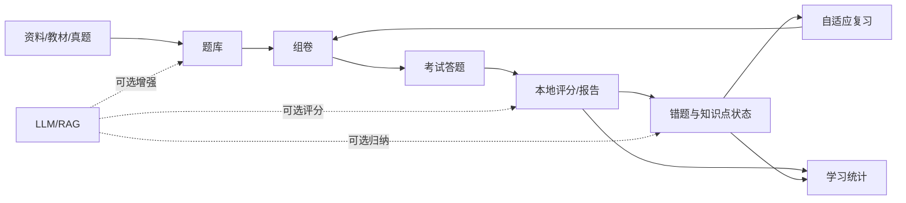
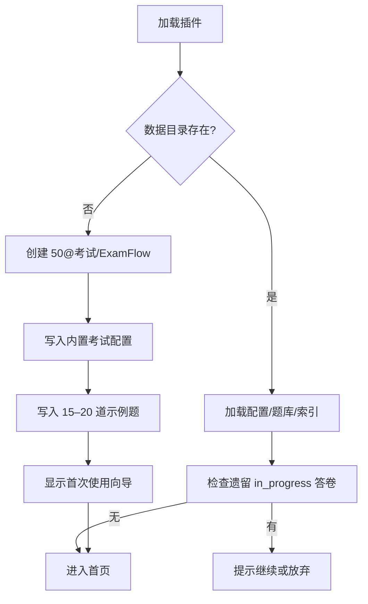
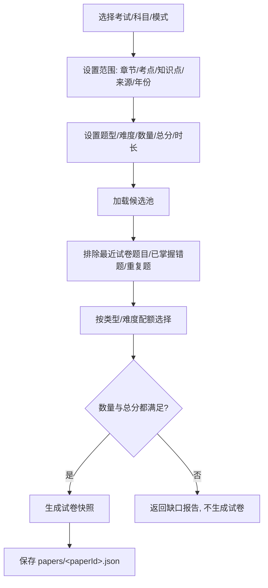
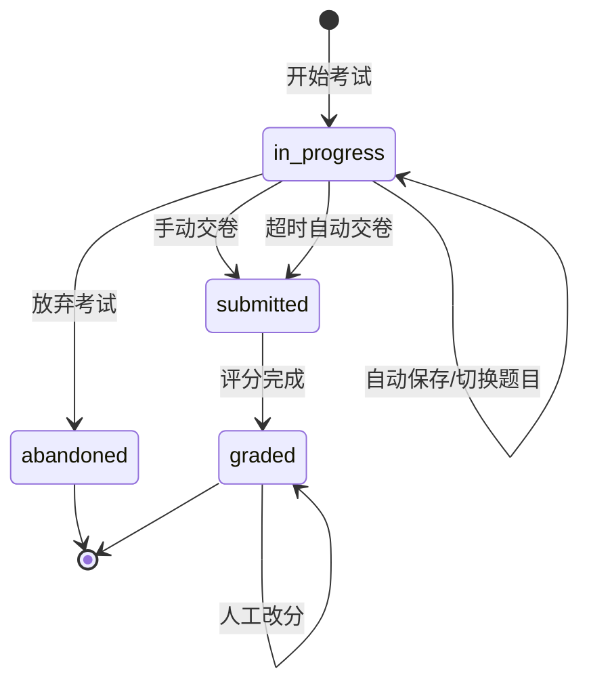
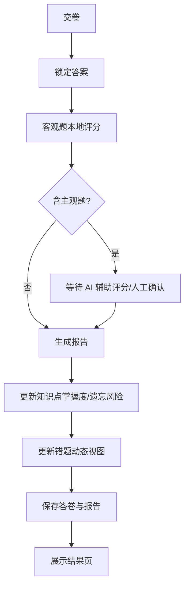
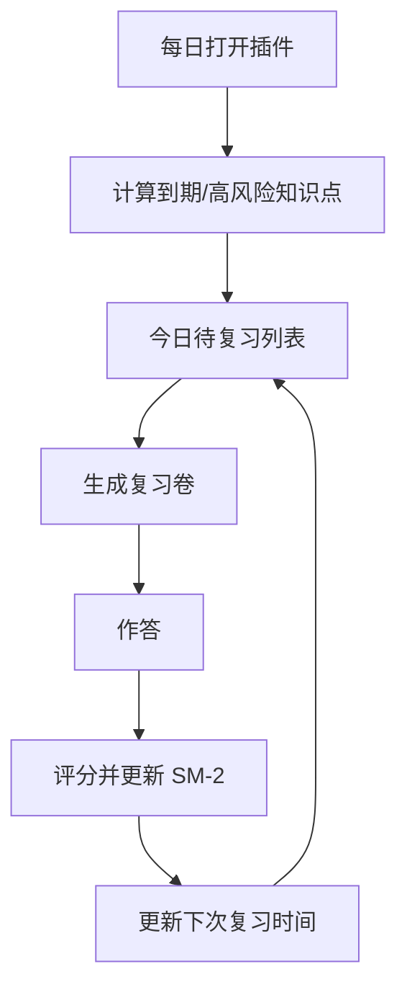
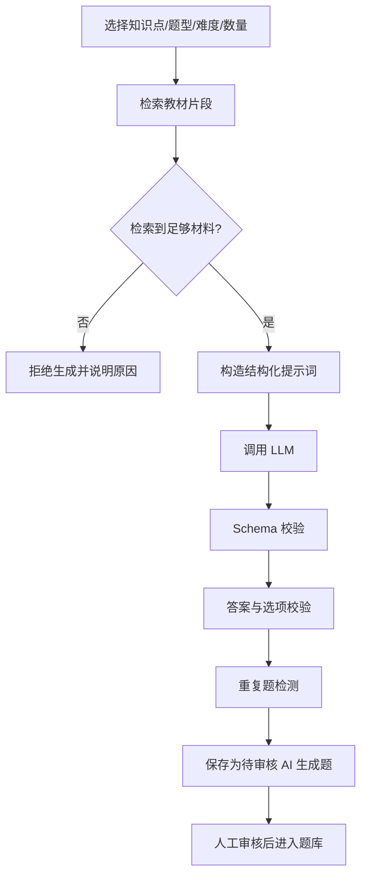
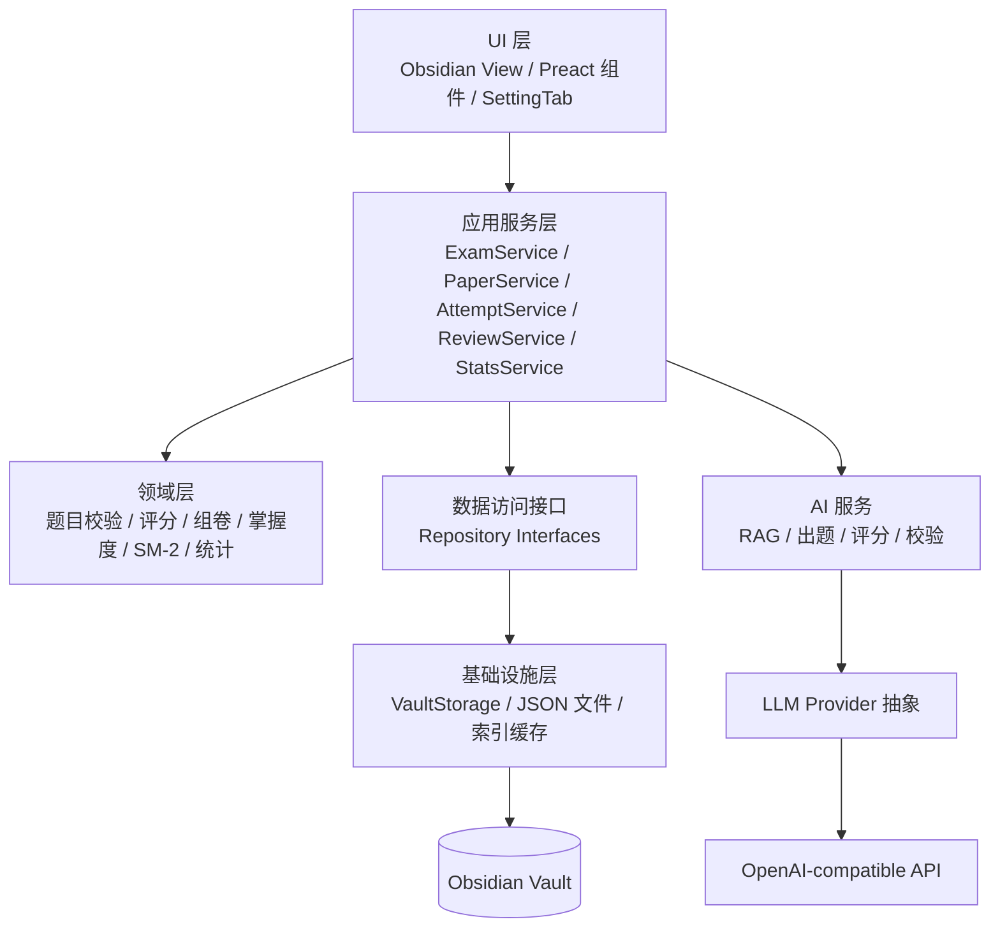
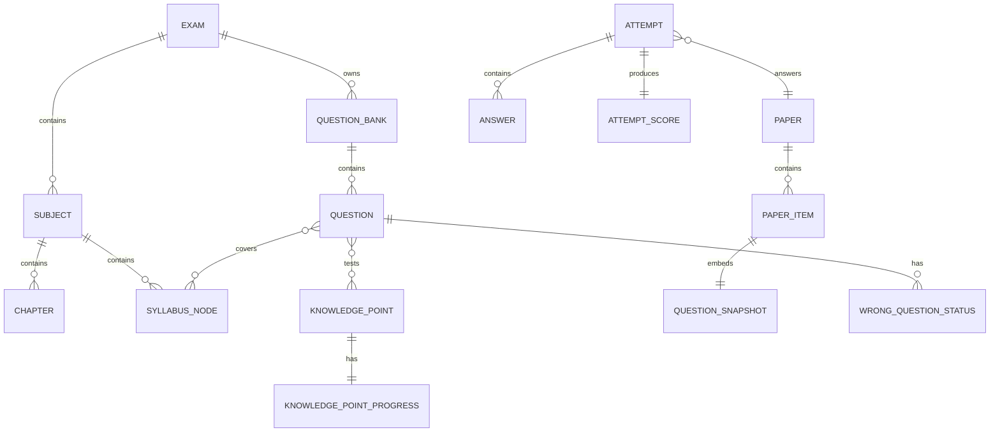

---
tags:
  - ExamFlow
  - 需求设计
created: 2026-10-29
updated: 2026-10-29
status: 讨论稿
---

# ExamFlow 需求设计文档

> 本文档依据 `doc/Obsidian ExamFlow 原始需求文档.md` 编写，并结合 2026-10-29 多轮设计决策收敛为可实施方案。当前为**讨论稿**：确认后才创建实施计划并开始编码。术语以根目录 `GLOSSARY.md` 为准。

## 0. 决策摘要

| 编号 | 决策项 | 结论 |
|---|---|---|
| D01 | 总交付范围 | 直接做到 V1.0；V0.1、V0.2、V0.3 作为阶段验收与 Git 提交节点 |
| D02 | 阶段推进方式 | 连续实施，不在阶段间停下等待；阶段末提交，全部完成后统一验收 |
| D03 | 代码位置 | `D:\workspace_empty\obsidian-exam-flow`，构建产物复制到主 vault `.obsidian/plugins/ExamFlow/` |
| D04 | 数据目录 | vault 内新建 `50@考试/ExamFlow/` |
| D05 | V0.1 题型 | 单选、多选、判断、填空；案例、论文等主观题在 V1.0 完整落地 |
| D06 | 组卷模式 | 7 种模式全部实现；V0.1 做 1–4，V0.2 做 5–7 |
| D07 | 题库存储 | 每个科目一个 JSON 题库；Markdown 作为导出/阅读形式 |
| D08 | 知识点存储 | 每个知识点一个 Markdown；动态学习状态另存 JSON |
| D09 | 试卷快照 | 试卷 JSON 内嵌完整题目快照；答卷只存作答与评分 |
| D10 | 客观题评分 | 多选全对才得分；填空归一化匹配，多空独立计分 |
| D11 | 计时与恢复 | 绝对时间计时，退出不暂停；恢复按剩余时间，超时自动交卷 |
| D12 | UI 技术 | Preact 负责复杂有状态视图；设置页用 Obsidian 原生 `SettingTab` |
| D13 | API Key | 默认仅内存；可选设备本地记住，使用 `app.saveLocalStorage`，绝不写入 vault |
| D14 | 数据发送授权 | 全局开关 + 首次确认 + 每次操作可预览/取消 |
| D15 | PDF 范围 | 只处理文本层 PDF；`pdfjs-dist` 仅 V1.0 引入，懒加载/分批；不做 OCR |
| D16 | 题库切分 | 按科目切分，`banks/<subjectId>.json` |
| D17 | 组卷不足 | 严格失败并输出缺口报告；V0.3 才允许 AI 补题且需确认 |
| D18 | 重复题 | 默认排除最近 3 次试卷出现过的题；疑似重复警告不自动合并 |
| D19 | 错题集 | 基于答卷动态视图；至少错一次且未标记已掌握 |
| D20 | 答卷状态 | `in_progress → submitted → graded`，另有 `abandoned`；交卷后答案锁定 |
| D21 | SM-2 粒度 | 以知识点为调度单位；重要度不改变 SM-2 间隔 |
| D22 | RAG 范围 | 用户配置的资料目录 + 教材文本层 + 题目解析；本地 BM25 为主 |
| D23 | 备份格式 | 版本化 JSON 包，备份到 vault 内 `_backup/<时间戳>/` |
| D24 | 视图结构 | 单个 `ExamFlow` 主视图 + Preact 内部路由；考试模式可全屏 |
| D25 | 题目版本 | `version+1`，不保留完整历史正文；历史可复现依赖试卷快照 |
| D26 | PDF 文本 | 只进本地索引缓存；可选导出 Markdown |
| D27 | 考纲数据 | 内置软考三科 + 教材章节/大纲骨架；V1.0 支持导入 Markdown/JSON |
| D28 | 掌握度/风险 | 掌握度 = 近期加权正确率 70% + 自评 30%；遗忘风险 = 紧迫度 60% + 错误率 40% |
| D29 | 同步冲突 | 写入前检测外部变更，生成冲突副本并人工处理；答卷交卷后不可变 |
| D30 | 阶段验收 | 构建 + 核心单测 + 主 vault 定向冒烟 + 文档更新；不默认全量回归 |
| D31 | 示例数据 | 首次启动创建数据目录、内置考试配置、15–20 道示例题，可一键移除 |
| D32 | 插件标识 | id `ExamFlow`，名称 `ExamFlow`，`minAppVersion` 1.5.0，作者 `Emptypty` |
| D33 | 文档位置 | 工程文档放 `doc/`；`GLOSSARY.md` 放仓库根目录 |

---

## 1. 需求规格

### 1.1 产品目标

ExamFlow 是运行在 Obsidian 内的本地优先考试与自适应复习插件。它把教材、考纲、真题、错题和学习笔记组织成可组卷、可作答、可批阅、可复习、可统计的闭环。

首个重点适配场景是**软考高级系统架构设计师**，但考试、科目、章节、考纲、题型、评分规则和复习策略都必须配置化，不能把该考试写死。

最高优先级原则：

1. 本地优先：题库管理、考试、客观题评分、错题记录、复习计划不依赖网络。
2. 离线核心可用：无 LLM 配置也能完成 V0.1/V0.2 的全部核心流程。
3. 云端 AI 增强：AI 只做辅助生成、辅助提取、辅助评分和辅助归纳，不替代确定性规则。
4. 知识可追溯：每道题保留来源性质、来源位置和生成方式；AI 题永不冒充真题。
5. 数据归用户所有：Markdown/JSON 开放格式，可导出、可迁移、可备份。
6. 无额外服务器：不依赖 Docker、数据库、Python 后端或独立 Web 服务。

### 1.2 首个场景的默认配置

内置一套可编辑的“软考高级系统架构设计师”配置，作为首次启动的种子数据：

| 科目 | 默认题型 | 默认题量 | 默认总分 | 默认时长 |
|---|---|---|---|---|
| 综合知识 | 单选（可扩展为多选、判断、填空） | 75 | 75 | 150 分钟 |
| 案例分析 | 案例分析 | 3 | 75 | 90 分钟 |
| 论文 | 论文 | 4 选 1 | 75 | 120 分钟 |

内置章节采用《系统架构设计师教程（第 2 版）》20 章，并补充 vault 中已有的 9 个大纲扩展专题，共 29 个章节节点：

| 编号 | 章节名称 | 对应资料 |
|---|---|---|
| 01 | 绪论 | 知识专题 `01-架构概览与架构师思维` |
| 02 | 计算机系统基础知识 | `02-计算机系统网络与UML` |
| 03 | 信息系统基础知识 | `03-信息系统与企业信息化` |
| 04 | 信息安全技术基础知识 | `04-信息安全与安全架构` |
| 05 | 软件工程基础知识 | `05-软件工程与需求管理` |
| 06 | 数据库设计基础知识 | `06-数据库理论与设计` |
| 07 | 系统架构设计基础知识 | `07-软件架构风格与架构复用` |
| 08 | 系统质量属性与架构评估 | `08-质量属性与架构评估` |
| 09 | 软件可靠性基础知识 | `09-可靠性与可用性` |
| 10 | 软件架构的演化和维护 | `10-架构演化与维护` |
| 11 | 未来信息综合技术 | `11-新技术概念与应用边界` |
| 12 | 信息系统架构设计理论与实践 | `12-企业架构与ADM` |
| 13 | 层次式架构设计理论与实践 | `13-层次式架构与数据访问` |
| 14 | 云原生架构设计理论与实践 | `14-云原生与微服务` |
| 15 | 面向服务架构设计理论与实践 | `15-SOA与企业集成` |
| 16 | 嵌入式系统架构设计理论与实践 | `16-嵌入式与实时系统` |
| 17 | 通信系统架构设计理论与实践 | `17-通信与网络架构` |
| 18 | 安全架构设计理论与实践 | `04-信息安全与安全架构` |
| 19 | 大数据架构设计理论与实践 | `18-大数据架构与批流处理` |
| 20 | 系统架构设计师论文写作要点 | `20-论文写作与项目素材` |
| 21 | 大纲补充：AI 与大模型应用 | `21-AI与大模型应用` |
| 22 | 大纲补充：区块链共识与智能合约 | `22-区块链共识与智能合约` |
| 23 | 大纲补充：数字孪生与 CPS 架构 | `23-数字孪生与CPS架构` |
| 24 | 大纲补充：边缘计算与云边协同 | `24-边缘计算与云边协同` |
| 25 | 大纲补充：国产化适配与迁移设计 | `25-国产化适配与迁移设计` |
| 26 | 大纲补充：标准化与知识产权 | `26-标准化与知识产权` |
| 27 | 大纲补充：应用数学与运筹 | `27-应用数学与运筹` |
| 28 | 大纲补充：专业英语与架构术语 | `28-专业英语与架构术语` |
| 29 | 大纲补充：系统计划与可行性分析 | `29-系统计划与可行性分析` |

说明：这是**起始骨架**，不是官方考纲的完整转录；用户可在 `config/exams.json` 中修改。V1.0 提供从 Markdown/JSON 导入考纲的功能。

### 1.3 用户故事

| 编号 | 用户故事 | 阶段 |
|---|---|---|
| US-01 | 首次安装后，我能看到内置考试配置和示例题，并完成一次组卷、答题、评分闭环 | V0.1 |
| US-02 | 我能手动录入题目，或导入 JSON 题库，并为题目标注来源、年份、知识点和审核状态 | V0.1 |
| US-03 | 我能按大纲、章节、真题场次、错题或重要知识点组卷，组卷前看到缺口而不是收到一份残缺试卷 | V0.1/V0.2 |
| US-04 | 我能在桌面端完整答题，随时标记疑问题目；关闭 Obsidian 后重新打开可以恢复考试 | V0.1 |
| US-05 | 交卷后我能看到总分、逐题得分、知识点表现、薄弱点和推荐复习内容 | V0.1 |
| US-06 | 我能查看错题、记录错误原因、标记已掌握，并基于错题重新组卷 | V0.1 |
| US-07 | 我能看到今日待复习、即将遗忘和重要知识点，并生成每日复习试卷 | V0.2 |
| US-08 | 我能看到成绩趋势、各科目正确率、知识点掌握度、错题分布和遗忘风险分布 | V0.2 |
| US-09 | 我能配置自己的 OpenAI-compatible 模型，用它辅助提取知识点、出题、校验和评分 | V0.3 |
| US-10 | 我能导入文本层 PDF，把教材片段用于检索和 AI 辅助；扫描版会明确提示不支持 | V1.0 |
| US-11 | 我能备份、恢复和迁移全部数据；多端同步发生冲突时，数据不会被静默覆盖 | V1.0 |
| US-12 | 我能在 iPhone 上打开插件并完成核心流程；本轮只做代码层兼容和响应式适配，真机验证如实标注 | V1.0 |

### 1.4 功能需求与阶段映射

| 模块 | V0.1 | V0.2 | V0.3 | V1.0 |
|---|---|---|---|---|
| A 资料与知识库 | 题目关联笔记路径；手动知识点标签 | 知识点 CRUD；从知识专题导入；题目-知识点关联 | AI 辅助提取知识点与关系 | PDF 文本导入；增量索引 |
| B 题库 | CRUD、JSON 导入导出、去重、审核状态、示例题 | 知识点筛选与统计 | AI 出题、AI 校验、错题变式 | 大题库分页/懒加载；批量导入 |
| C 组卷 | 模式 1–4、手动选题、规则组卷、缺口报告 | 模式 5–7、自适应权重 | AI 补题（可选、需确认） | 完整考试配置、模板、性能优化 |
| D 考试答题 | 客观题、倒计时、导航、标记、自动保存、恢复、交卷 | 复习卷入口 | 简答题文本作答；主观题评分所需的答案采集 | 案例/论文长文本、完整三科流程 |
| E 批阅评分 | 客观题本地评分、报告 | 知识点表现与推荐 | 主观题 AI 辅助评分、人工调整 | 多维度评分、评分依据展示 |
| F 错题 | 动态错题视图、错误原因、已掌握标记 | 错题强化组卷 | AI 归纳常见错误、变式题 | 错题导出/归档 |
| G 自适应复习 | — | SM-2、今日待复习、易忘/薄弱/重要列表、每日复习卷 | AI 复习建议 | 调度参数调优、性能优化 |
| H 统计 | 基础成绩与正确率 | 趋势、掌握度、错题分布、遗忘风险、完成量 | AI 学情摘要（可选） | 大数据量性能优化 |

### 1.5 非功能需求

| 类别 | 要求 |
|---|---|
| 性能 | 2000 道题的题库在 Windows 桌面端打开列表 < 1s（索引已建）；组卷 < 500ms；答题输入不阻塞 |
| 移动端 | 不引用 Node/Electron API；触控目标 ≥ 44px；小屏无横向滚动；重任务分批执行 |
| 可靠性 | 答题自动保存；意外退出可恢复；写入失败不破坏原文件；JSON 损坏可备份并提示 |
| 安全 | API Key 不写入 vault、不写日志、不导出；请求前明确数据范围；日志脱敏 |
| 可维护性 | TypeScript strict；领域逻辑与 Obsidian API 解耦；核心逻辑单测；无过度设计 |
| 可迁移性 | 数据为开放 Markdown/JSON；导出包含 schemaVersion；恢复按 ID 合并 |
| 可测试性 | 评分、组卷、SM-2、统计、Schema 校验均为纯函数或可注入依赖 |

### 1.6 明确不做的事

1. 不搭建服务端、数据库、Docker、Python/FastAPI 或独立 Web 服务。
2. 不引入独立向量数据库；语义检索只作为可选的云端 Embedding + 本地缓存。
3. 不依赖 Obsidian 之外的 PDF 阅读器插件。
4. 不在 V0.1 做 OCR；扫描版 PDF 明确提示不支持。
5. 不让普通题库管理、考试、客观题评分、错题记录和复习计划依赖网络。
6. 不承诺 AI 评分与官方阅卷一致；AI 评分只作为参考。
7. 不自动把 AI 生成题标记为真题。
8. 不默认执行全量回归；按阶段做定向验证。

---

## 2. 核心业务流程

### 2.1 总体学习闭环



### 2.2 首次启动



### 2.3 组卷



### 2.4 考试与恢复



### 2.5 交卷、评分与状态更新



### 2.6 自适应复习



### 2.7 AI 出题（V0.3）



---

## 3. 技术可行性与平台限制

### 3.1 已核实的环境事实

| 事实 | 结论 |
|---|---|
| 当前 Obsidian 版本 | 1.14.5；`obsidian` npm 类型包 1.14.4 |
| 当前 vault | `D:\Obsidian\Notes-LiveSync`，已装 LiveSync 等 19 个社区插件 |
| Node/npm | Node 24.21.0，npm 11.19.0；npm registry 可达 |
| `DataAdapter` | 提供 `read/write/process/rename/remove/mkdir/list/stat` 等；`process` 文档描述为原子读-改-写 |
| 设备本地存储 | `app.loadLocalStorage(key)` / `app.saveLocalStorage(key, value)` 可用，按 vault 隔离 |
| `requestUrl` | 可绕过 CORS；返回完整响应，不支持流式 |
| `fetch` | 浏览器 API 可用，但是否能流式取决于目标 API 的 CORS 与响应头 |
| Web Crypto | 现代 WebView 支持 `crypto.randomUUID`；需提供 `crypto.getRandomValues` 降级 |
| PDF.js | `pdfjs-dist` 包解压约 34MB；实际打包体积取决于构建；移动端 worker 支持需验证 |
| 安全存储 | Obsidian 没有官方加密凭据 API；Electron `safeStorage` 不对插件暴露，且移动端不可用 |

### 3.2 平台限制与对策

| 限制 | 对策 |
|---|---|
| 无 Node/Electron | 所有文件操作走 `app.vault.adapter`；不使用 `fs`、`path`、`child_process` |
| `requestUrl` 不流式 | 默认非流式；流式开关使用 `fetch` + `AbortController`，失败时回退到 `requestUrl` |
| 无安全存储 | 默认仅内存；设备本地记住使用 `app.saveLocalStorage`，明确提示明文风险；绝不写入 vault |
| PDF.js 体积/worker | 仅 V1.0 引入；动态加载；`disableWorker` 或内联 worker；按页分批处理 |
| LiveSync 小文件多 | 题库按科目聚合；索引缓存放本地 IndexedDB/localStorage，不进 vault |
| 移动端性能 | 分页、懒加载、`setTimeout` 分批；避免长同步任务阻塞 UI |
| 同步冲突 | 文件级冲突检测 + 冲突副本 + 人工处理；答卷交卷后不可变 |
| 桌面/移动 UI 差异 | 响应式 CSS；触控优先；不用 hover-only 交互 |
| 插件 ID 大小写 | 本地使用 `ExamFlow` 可行；若未来提交社区市场，可能需要改为小写 ID，届时迁移目录与设置 |

### 3.3 关于“安全存储”的诚实说明

Obsidian 插件没有官方加密凭据存储接口。`app.saveLocalStorage` 只是**设备本地、按 vault 隔离**的普通键值存储，不是加密存储；拥有该设备访问权限的人仍可能读取。因此：

- 默认模式：API Key 只保存在内存，重启 Obsidian 后需重新输入。
- 可选模式：用户明确勾选“在此设备记住”后，写入 `app.saveLocalStorage('examflow.apiKey', key)`；设置页展示风险说明。
- API Key 永不写入 `data.json`、vault 笔记、导出文件、日志或错误信息。
- 日志中的 `Authorization` 头、请求体中的密钥字段一律脱敏。

### 3.4 关于 PDF 的诚实说明

- V1.0 只支持有文本层的 PDF。图像型/扫描版 PDF 会提示“无法提取文本，暂不支持 OCR”。
- `pdfjs-dist` 只在用户执行 PDF 导入时动态加载；不放在主包启动路径上。
- 提取文本只进入本地索引缓存，不自动写入 vault；用户可显式导出为 Markdown。
- 提取质量取决于 PDF 文本层；页码与章节可能不准确，索引结果必须带来源页码并允许人工修正。

---

## 4. 架构设计

### 4.1 分层



依赖规则：

1. `domain/` 不导入 `obsidian`、`preact` 或任何 UI 模块。
2. `data/` 可以导入 `obsidian`，实现 Repository 接口。
3. `services/` 依赖领域与 Repository 接口，不直接操作 DOM。
4. `ui/` 只通过服务层访问业务；不直接读写文件。
5. `ai/` 依赖 Provider 接口与 Schema 校验，不直接操作 UI。
6. `main.ts` 负责组装依赖，不承载业务逻辑。

### 4.2 模块职责

| 模块 | 职责 |
|---|---|
| `core` | ID、时间、错误、JSON、PRNG、字符串归一化、Result 类型 |
| `domain/question` | 题目校验、评分、去重、答案归一化 |
| `domain/paper` | 组卷规则、7 种模式、缺口报告、题目快照 |
| `domain/attempt` | 答卷生命周期、状态迁移、报告生成 |
| `domain/review` | SM-2、掌握度、遗忘风险、复习优先级 |
| `domain/stats` | 统计指标计算 |
| `data/repositories` | 考试、题库、试卷、答卷、知识点、状态的持久化 |
| `data/index` | 题目索引、全文检索、BM25 |
| `data/storage` | vault 文件读写、原子写入、冲突检测、迁移 |
| `ai/provider` | OpenAI-compatible 客户端、超时、重试、取消、并发、Token/费用 |
| `ai/rag` | 资料分块、索引、检索、来源引用 |
| `ai/generation` | AI 出题、知识点提取、Schema 校验、去重 |
| `ai/grading` | 主观题辅助评分、评分依据 |
| `services` | 编排业务流程、事务边界、幂等与锁 |
| `ui` | 主视图、页面、组件、设置、命令、移动端适配 |
| `seed` | 内置考试配置、示例题 |

### 4.3 工程目录结构

```text
obsidian-exam-flow/
├── manifest.json
├── package.json
├── tsconfig.json
├── esbuild.config.mjs
├── vitest.config.ts
├── styles.css
├── GLOSSARY.md
├── doc/
│   ├── Obsidian ExamFlow 原始需求文档.md
│   └── ExamFlow-需求设计文档.md
├── docs/
│   └── adr/
├── scripts/
│   └── install-to-vault.mjs
├── src/
│   ├── main.ts
│   ├── settings.ts
│   ├── constants.ts
│   ├── types/
│   │   ├── domain.ts
│   │   ├── settings.ts
│   │   └── llm.ts
│   ├── core/
│   │   ├── ids.ts
│   │   ├── time.ts
│   │   ├── errors.ts
│   │   ├── result.ts
│   │   ├── prng.ts
│   │   ├── normalize.ts
│   │   └── json.ts
│   ├── domain/
│   │   ├── question/
│   │   │   ├── validation.ts
│   │   │   ├── scoring.ts
│   │   │   └── dedupe.ts
│   │   ├── paper/
│   │   │   ├── config.ts
│   │   │   ├── generator.ts
│   │   │   ├── modes.ts
│   │   │   └── snapshot.ts
│   │   ├── attempt/
│   │   │   ├── lifecycle.ts
│   │   │   └── report.ts
│   │   ├── review/
│   │   │   ├── sm2.ts
│   │   │   ├── mastery.ts
│   │   │   └── priority.ts
│   │   └── stats/
│   │       └── compute.ts
│   ├── data/
│   │   ├── paths.ts
│   │   ├── storage/
│   │   │   ├── vault-storage.ts
│   │   │   ├── atomic-write.ts
│   │   │   └── conflict.ts
│   │   ├── repositories/
│   │   │   ├── exam-repository.ts
│   │   │   ├── bank-repository.ts
│   │   │   ├── paper-repository.ts
│   │   │   ├── attempt-repository.ts
│   │   │   ├── knowledge-repository.ts
│   │   │   └── state-repository.ts
│   │   ├── index/
│   │   │   ├── question-index.ts
│   │   │   ├── bm25.ts
│   │   │   └── index-store.ts
│   │   ├── backup.ts
│   │   └── migrations.ts
│   ├── ai/
│   │   ├── provider.ts
│   │   ├── openai-compatible.ts
│   │   ├── prompts.ts
│   │   ├── schemas.ts
│   │   ├── question-generator.ts
│   │   ├── knowledge-extractor.ts
│   │   ├── subjective-grader.ts
│   │   ├── wrong-summarizer.ts
│   │   └── rag.ts
│   ├── services/
│   │   ├── exam-service.ts
│   │   ├── bank-service.ts
│   │   ├── paper-service.ts
│   │   ├── attempt-service.ts
│   │   ├── review-service.ts
│   │   ├── stats-service.ts
│   │   ├── import-export-service.ts
│   │   ├── backup-service.ts
│   │   └── index-service.ts
│   ├── ui/
│   │   ├── view.tsx
│   │   ├── router.tsx
│   │   ├── components/
│   │   │   ├── layout.tsx
│   │   │   ├── question-renderer.tsx
│   │   │   ├── answer-input.tsx
│   │   │   ├── timer.tsx
│   │   │   ├── question-palette.tsx
│   │   │   ├── charts/
│   │   │   └── empty-state.tsx
│   │   ├── pages/
│   │   │   ├── home.tsx
│   │   │   ├── knowledge.tsx
│   │   │   ├── bank.tsx
│   │   │   ├── generate.tsx
│   │   │   ├── exam.tsx
│   │   │   ├── report.tsx
│   │   │   ├── wrong.tsx
│   │   │   ├── review.tsx
│   │   │   └── stats.tsx
│   │   ├── modals/
│   │   │   ├── question-editor.tsx
│   │   │   ├── import-bank.tsx
│   │   │   ├── conflict-center.tsx
│   │   │   └── confirm.tsx
│   │   ├── settings-tab.ts
│   │   └── commands.ts
│   └── seed/
│       ├── exam-config.ts
│       └── sample-questions.ts
└── tests/
    ├── domain/
    ├── data/
    ├── ai/
    └── fixtures/
```

### 4.4 关键设计决策

以下决策符合 ADR 的“难回退、非显然、有取舍”标准，实施前会分别落为 ADR：

1. **题库用科目级 JSON，Markdown 只做导出**：原需求建议“Markdown + YAML 优先”，但你选择 JSON 以换取同步与性能。代价是 vault 中不能直接逐题 diff；补偿是提供 Markdown 导出和题目编辑 UI。
2. **动态学习状态与知识点正文分离**：知识点正文用 Markdown；掌握度、SM-2、错题标记等高频变化数据放 JSON，避免每次答题都改写 Markdown 引发同步冲突。
3. **试卷不可变 + 题目快照**：保证历史答卷可复现，代价是试卷文件体积增加。
4. **默认仅内存保存 API Key**：Obsidian 没有安全存储；设备本地记住只是便利选项，不是“安全存储”。
5. **本地 BM25 优先，云端 Embedding 可选**：不引入向量数据库，索引可重建。
6. **单主视图 + Preact 局部使用**：避免多标签页和移动端返回栈混乱；设置页保持 Obsidian 原生风格。

---

## 5. 领域模型

### 5.1 实体关系



### 5.2 实体说明

| 实体 | 说明 | 持久化位置 |
|---|---|---|
| ExamConfig | 考试、科目、章节、考纲骨架 | `config/exams.json` |
| QuestionBank | 某科目的题目集合 | `banks/<subjectId>.json` |
| Question | 单题内容、答案、评分规则、来源、版本 | 题库 JSON 内 |
| KnowledgePoint | 知识点正文与静态属性 | `knowledge/<kpId>.md` |
| KnowledgePointProgress | 掌握度、SM-2、近期表现 | `state/kp-progress.json` |
| Paper | 试卷元数据 + 题目快照 | `papers/<paperId>.json` |
| Attempt | 一次作答、评分、报告 | `attempts/<attemptId>.json` |
| WrongQuestionStatus | 已掌握标记与备注 | `state/wrong-status.json` |
| CrossDeviceMeta | 设备 ID、写入基线、冲突记录 | 插件本地存储 / 冲突目录 |

---

## 6. 数据模型

### 6.1 通用约定

- 所有实体必须有稳定唯一 ID；ID 前缀标明类型：`exam_`、`subj_`、`chap_`、`kp_`、`q_`、`bank_`、`paper_`、`attempt_`。
- ID 生成优先 `crypto.randomUUID()`，降级为 `crypto.getRandomValues` 拼接；不使用时间戳单独作为 ID。
- 所有时间使用 ISO 8601 字符串，带时区偏移或统一 UTC；“今天”按本地时区计算。
- 每个文件带 `schemaVersion`；迁移函数按版本顺序执行。
- 分数用 number 存储；展示时保留最多 2 位小数。
- 枚举值使用英文稳定标识，UI 显示中文标签；不在存储中保存中文标签。

### 6.2 通用类型

```ts
export type Id = string;
export type IsoDateTime = string;
export type IsoDate = string;
export type Score = number;

export interface EntityMeta {
  id: Id;
  schemaVersion: number;
  createdAt: IsoDateTime;
  updatedAt: IsoDateTime;
}

export interface Result<T, E = string> {
  ok: boolean;
  value?: T;
  error?: E;
}
```

### 6.3 考试与结构

```ts
export type QuestionType =
  | 'single_choice'
  | 'multiple_choice'
  | 'true_false'
  | 'fill_blank'
  | 'short_answer'
  | 'case_analysis'
  | 'essay';

export type Difficulty = 1 | 2 | 3 | 4 | 5;
export type Importance = 1 | 2 | 3 | 4 | 5;

export interface SubjectConfig {
  id: Id;
  name: string;
  code?: string;
  questionTypes: QuestionType[];
  defaultDurationMinutes: number;
  defaultTotalPoints: number;
  order: number;
}

export interface ChapterConfig {
  id: Id;
  subjectId: Id;
  parentId?: Id;
  name: string;
  order: number;
  sourceNotePath?: string;
}

export interface SyllabusNode {
  id: Id;
  subjectId: Id;
  parentId?: Id;
  name: string;
  order: number;
  description?: string;
}

export interface ExamConfig extends EntityMeta {
  name: string;
  description?: string;
  subjects: SubjectConfig[];
  chapters: ChapterConfig[];
  syllabus: SyllabusNode[];
  defaultPaperConfig?: Partial<PaperConfig>;
}
```

### 6.4 题目与题库

```ts
export type SourceType =
  | 'real_exam'
  | 'manual'
  | 'sample'
  | 'ai_generated'
  | 'wrong_derived'
  | 'knowledge_point_drill';

export type SourceNature =
  | 'official'
  | 'institution'
  | 'recall'
  | 'community'
  | 'unknown';

export type ReviewStatus = 'draft' | 'pending_review' | 'approved' | 'rejected';

export type GenerationMethod = 'manual' | 'rule' | 'ai' | 'import' | 'derived';

export interface SourceRef {
  type: SourceType;
  nature: SourceNature;
  title?: string;
  examYear?: number;
  examSession?: string;
  paperName?: string;
  questionNo?: string;
  page?: number;
  url?: string;
  notePath?: string;
  note?: string;
}

export interface QuestionOption {
  key: string;
  text: string;
}

export interface FillBlankAnswer {
  accepted: string[];
}

export type QuestionAnswer =
  | { kind: 'single_choice'; optionKey: string }
  | { kind: 'multiple_choice'; optionKeys: string[] }
  | { kind: 'true_false'; value: boolean }
  | { kind: 'fill_blank'; blanks: FillBlankAnswer[] }
  | { kind: 'subjective'; referenceAnswer: string; rubric: RubricItem[] };

export interface RubricItem {
  id: Id;
  description: string;
  points: number;
  requiredPoints?: string[];
}

export interface FillBlankPolicy {
  trim: boolean;
  normalizeFullWidth: boolean;
  normalizePunctuation: boolean;
  caseSensitive: boolean;
  perBlankPartial: boolean;
}

export interface ScoringRule {
  points: number;
  multiSelectPolicy: 'all_or_nothing' | 'partial';
  fillBlankPolicy: FillBlankPolicy;
  manualOverrideAllowed: boolean;
}

export interface Question extends EntityMeta {
  type: QuestionType;
  stem: string;
  options?: QuestionOption[];
  answer: QuestionAnswer;
  explanation?: string;
  scoringRule: ScoringRule;
  difficulty: Difficulty;
  examId: Id;
  subjectId: Id;
  chapterIds: Id[];
  syllabusNodeIds: Id[];
  knowledgePointIds: Id[];
  source: SourceRef;
  generationMethod: GenerationMethod;
  reviewStatus: ReviewStatus;
  tags: string[];
  version: number;
  duplicateOf?: Id;
  extra?: Record<string, unknown>;
}

export interface QuestionBank extends EntityMeta {
  name: string;
  examId: Id;
  subjectId: Id;
  questions: Question[];
}
```

题目校验规则（`validation.ts`）：

1. `single_choice`：至少 2 个选项；`answer.optionKey` 必须存在；选项 key 唯一。
2. `multiple_choice`：至少 2 个选项；`answer.optionKeys` 非空、无重复、均存在。
3. `true_false`：`answer.value` 为布尔；不需要 options。
4. `fill_blank`：题干中的 `{{1}}`、`{{2}}`… 数量与 `answer.blanks.length` 一致；每个空的 `accepted` 至少 1 个非空答案。
5. `short_answer` / `case_analysis` / `essay`：`referenceAnswer` 非空；案例/论文必须有 rubric；rubric 分值之和等于 `scoringRule.points`。
6. `points > 0`；难度 1–5；考试/科目/章节/知识点 ID 必须存在于当前配置。
7. `source.type === 'ai_generated'` 时，`reviewStatus` 只能是 `draft` 或 `pending_review`，且不得为 `real_exam`。
8. `source.type === 'real_exam'` 时，必须提供 `source.nature`；若 `nature` 为 `recall`/`community`，UI 明确显示“回忆版/社区版”，不得显示为“官方真题”。
9. `sample` 不得填写真实年份或声称来自历年真题。

### 6.5 试卷

```ts
export type PaperMode =
  | 'syllabus_mock'
  | 'chapter_drill'
  | 'real_exam_mock'
  | 'wrong_question_drill'
  | 'forgotten_kp_review'
  | 'important_kp_drill'
  | 'adaptive';

export interface PaperConfig {
  examId: Id;
  subjectIds: Id[];
  mode: PaperMode;
  chapterIds?: Id[];
  syllabusNodeIds?: Id[];
  knowledgePointIds?: Id[];
  questionCounts: Partial<Record<QuestionType, number>>;
  difficultyCounts?: Partial<Record<Difficulty, number>>;
  sourceTypes?: SourceType[];
  sourceNatures?: SourceNature[];
  examYears?: number[];
  reviewStatuses?: ReviewStatus[];
  totalPointsTarget?: number;
  durationMinutes: number;
  excludeRecentPapers: number;
  allowRepeatWithinPaper: boolean;
  seed?: number;
  aiSupplement?: boolean;
}

export interface PaperItem {
  index: number;
  questionId: Id;
  questionVersion: number;
  snapshot: Question;
  points: number;
}

export interface Paper extends EntityMeta {
  title: string;
  examId: Id;
  subjectIds: Id[];
  mode: PaperMode;
  config: PaperConfig;
  seed: number;
  items: PaperItem[];
  totalPoints: number;
  durationMinutes: number;
  generationMethod: GenerationMethod;
  sourceAttemptId?: Id;
  notes?: string;
}
```

### 6.6 答卷

```ts
export type AttemptStatus = 'in_progress' | 'submitted' | 'graded' | 'abandoned';

export type ErrorReason =
  | 'kp_unmastered'
  | 'concept_confusion'
  | 'weak_memory'
  | 'misread'
  | 'application_gap'
  | 'other';

export interface UserAnswer {
  kind: 'single_choice' | 'multiple_choice' | 'true_false' | 'fill_blank' | 'subjective';
  optionKey?: string;
  optionKeys?: string[];
  value?: boolean;
  blanks?: string[];
  text?: string;
}

export interface AnswerRecord {
  questionId: Id;
  answer: UserAnswer | null;
  flagged: boolean;
  updatedAt: IsoDateTime;
  timeSpentSeconds: number;
  errorReasons?: ErrorReason[];
  note?: string;
}

export interface ManualAdjustment {
  id: Id;
  questionId?: Id;
  originalPoints: number;
  adjustedPoints: number;
  reason: string;
  adjustedAt: IsoDateTime;
}

export interface QuestionScore {
  questionId: Id;
  index: number;
  points: number;
  earnedPoints: number;
  correct: boolean | 'partial';
  detail: string;
  matchedPoints?: string[];
  missingPoints?: string[];
  manualAdjusted?: boolean;
}

export interface AttemptScore {
  totalPoints: number;
  earnedPoints: number;
  accuracy: number;
  perQuestion: QuestionScore[];
  manualAdjustments: ManualAdjustment[];
  gradedAt: IsoDateTime;
}

export interface KpPerformance {
  knowledgePointId: Id;
  questionCount: number;
  correctCount: number;
  earnedPoints: number;
  totalPoints: number;
}

export interface AttemptReport {
  score: AttemptScore;
  byKnowledgePoint: KpPerformance[];
  byChapter: KpPerformance[];
  byType: {
    type: QuestionType;
    questionCount: number;
    correctCount: number;
    earnedPoints: number;
    totalPoints: number;
  }[];
  weakKnowledgePointIds: Id[];
  errorReasonCounts: Partial<Record<ErrorReason, number>>;
  recommendations: string[];
  nextPaperSuggestion?: Partial<PaperConfig>;
  generatedAt: IsoDateTime;
}

export interface Attempt extends EntityMeta {
  paperId: Id;
  paperTitle: string;
  paperMode: PaperMode;
  paperHash: string;
  examId: Id;
  subjectIds: Id[];
  status: AttemptStatus;
  startedAt: IsoDateTime;
  deadlineAt: IsoDateTime;
  submittedAt?: IsoDateTime;
  autoSubmitted?: boolean;
  answers: Record<Id, AnswerRecord>;
  activeQuestionIndex: number;
  score?: AttemptScore;
  report?: AttemptReport;
}
```

### 6.7 知识点与学习状态

```ts
export interface KnowledgePoint extends EntityMeta {
  name: string;
  examId: Id;
  subjectId: Id;
  chapterIds: Id[];
  syllabusNodeIds: Id[];
  importance: Importance;
  selfRating?: 1 | 2 | 3 | 4 | 5;
  definition?: string;
  relatedNotePaths: string[];
  tags: string[];
}

export interface OutcomeSample {
  at: IsoDateTime;
  scoreRatio: number;
  difficulty: Difficulty;
  timeSpentSeconds?: number;
}

export interface ReviewState {
  ease: number;
  intervalDays: number;
  repetitions: number;
  lapses: number;
  dueAt: IsoDate;
  lastReviewedAt?: IsoDateTime;
  lastQuality?: 0 | 1 | 2 | 3 | 4 | 5;
}

export interface KnowledgePointProgress {
  knowledgePointId: Id;
  mastery: number;
  recentOutcomes: OutcomeSample[];
  review: ReviewState;
  updatedAt: IsoDateTime;
}

export interface WrongQuestionStatus {
  questionId: Id;
  mastered: boolean;
  masteredAt?: IsoDateTime;
  note?: string;
  updatedAt: IsoDateTime;
}

export interface WrongQuestionEntry {
  questionId: Id;
  question?: Question;
  wrongCount: number;
  lastWrongAt: IsoDateTime;
  lastResult: 'wrong' | 'correct' | 'unanswered';
  attemptIds: Id[];
  errorReasons: ErrorReason[];
  mastered: boolean;
}
```

知识点 Markdown 格式：

```markdown
---
id: kp_7f3c2a9e-4b1d-4c8a-9e2f-1a2b3c4d5e6f
schemaVersion: 1
name: 质量属性场景
examId: exam_ruankao_senior_architect
subjectId: subj_comprehensive
chapterIds:
  - chap_08
syllabusNodeIds:
  - syl_quality
importance: 5
selfRating: 4
relatedNotePaths:
  - "20@领域/2005@SeniorArchitect/知识专题/08-质量属性与架构评估.md"
tags:
  - examflow/kp
createdAt: "2026-10-29T10:00:00+08:00"
updatedAt: "2026-10-29T10:00:00+08:00"
---

# 质量属性场景

> 定义、辨析与答题语言。

## 核心内容

...
```

说明：`mastery`、`review` 等高频变化字段不写入 Markdown frontmatter，而写入 `state/kp-progress.json`；知识点正文只在用户编辑内容时写入，减少同步冲突。

### 6.8 设置

```ts
export interface LLMProviderSettings {
  provider: 'openai_compatible';
  baseUrl: string;
  model: string;
  apiKeyMode: 'session' | 'device';
  timeoutMs: number;
  maxRetries: number;
  concurrency: number;
  streaming: boolean;
  temperature: number;
  maxTokens: number;
  pricePerMillionInput?: number;
  pricePerMillionOutput?: number;
  currency?: string;
}

export interface ExamFlowSettings {
  schemaVersion: number;
  dataFolder: string;
  activeExamId?: Id;
  ui: {
    pageSize: number;
    defaultPage: 'home';
  };
  review: {
    dailyQuestionLimit: number;
    dueSoonDays: number;
  };
  privacy: {
    aiEnabled: boolean;
    consentAcknowledgedAt?: IsoDateTime;
    allowedMaterialPaths: string[];
  };
  llm: LLMProviderSettings;
  backup: {
    lastBackupAt?: IsoDateTime;
  };
}
```

### 6.9 Vault 文件布局

```text
<vault>/50@考试/ExamFlow/
├── config/
│   └── exams.json
├── banks/
│   └── <subjectId>.json
├── knowledge/
│   └── <kpId>.md
├── papers/
│   └── <paperId>.json
├── attempts/
│   └── <attemptId>.json
├── state/
│   ├── kp-progress.json
│   ├── wrong-status.json
│   └── usage-log.json
├── exports/
│   └── <timestamp>/
├── _backup/
│   └── <timestamp>/
└── README.md
```

插件目录：

```text
<vault>/.obsidian/plugins/ExamFlow/
├── main.js
├── manifest.json
├── styles.css
└── data.json          # 仅设置；不含 API Key
```

索引缓存使用 Obsidian 设备本地存储（IndexedDB 优先，`app.saveLocalStorage` 仅存小型元数据），不进入 vault 同步。

### 6.10 题库 JSON 示例

```json
{
  "id": "bank_subj_comprehensive",
  "schemaVersion": 1,
  "name": "综合知识题库",
  "examId": "exam_ruankao_senior_architect",
  "subjectId": "subj_comprehensive",
  "createdAt": "2026-10-29T10:00:00+08:00",
  "updatedAt": "2026-10-29T10:00:00+08:00",
  "questions": [
    {
      "id": "q_7f3c2a9e-4b1d-4c8a-9e2f-1a2b3c4d5e6f",
      "schemaVersion": 1,
      "version": 1,
      "type": "single_choice",
      "stem": "以下哪一项最准确地描述了软件架构？",
      "options": [
        { "key": "A", "text": "系统的全部源代码" },
        { "key": "B", "text": "构成系统的元素、元素之间的关系以及指导设计与演化的原则" },
        { "key": "C", "text": "项目的进度计划" },
        { "key": "D", "text": "系统的部署清单" }
      ],
      "answer": { "kind": "single_choice", "optionKey": "B" },
      "explanation": "架构关注元素、关系与原则，而不是源代码或项目计划。",
      "scoringRule": {
        "points": 1,
        "multiSelectPolicy": "all_or_nothing",
        "fillBlankPolicy": {
          "trim": true,
          "normalizeFullWidth": true,
          "normalizePunctuation": true,
          "caseSensitive": false,
          "perBlankPartial": true
        },
        "manualOverrideAllowed": true
      },
      "difficulty": 2,
      "examId": "exam_ruankao_senior_architect",
      "subjectId": "subj_comprehensive",
      "chapterIds": ["chap_01"],
      "syllabusNodeIds": ["syl_architecture_design"],
      "knowledgePointIds": ["kp_architecture_definition"],
      "source": {
        "type": "sample",
        "nature": "unknown",
        "title": "ExamFlow 示例题",
        "note": "首次启动示例，非真题"
      },
      "generationMethod": "manual",
      "reviewStatus": "approved",
      "tags": ["示例题"],
      "createdAt": "2026-10-29T10:00:00+08:00",
      "updatedAt": "2026-10-29T10:00:00+08:00"
    }
  ]
}
```

### 6.11 异常与错误模型

```ts
export type ExamFlowErrorCode =
  | 'not_found'
  | 'invalid_data'
  | 'schema_mismatch'
  | 'write_failed'
  | 'conflict'
  | 'shortage'
  | 'llm_auth'
  | 'llm_rate_limit'
  | 'llm_timeout'
  | 'llm_network'
  | 'llm_invalid_response'
  | 'llm_aborted'
  | 'llm_server';

export class ExamFlowError extends Error {
  constructor(
    public readonly code: ExamFlowErrorCode,
    message: string,
    public readonly userMessage: string,
    public readonly cause?: unknown,
    public readonly retryable = false,
  ) {
    super(message);
    this.name = 'ExamFlowError';
  }
}
```

用户可见错误必须包含“发生了什么 + 可以怎么做”，不得暴露堆栈、API Key 或完整请求体。

---

## 7. 接口设计

### 7.1 存储接口

```ts
export interface FileStamp {
  mtime: number;
  size: number;
  hash: string;
}

export interface VaultStorage {
  exists(path: string): Promise<boolean>;
  readText(path: string): Promise<string | null>;
  writeText(path: string, content: string): Promise<void>;
  readJson<T>(path: string): Promise<T | null>;
  writeJson(path: string, value: unknown): Promise<void>;
  list(path: string): Promise<string[]>;
  mkdir(path: string): Promise<void>;
  remove(path: string): Promise<void>;
  stamp(path: string): Promise<FileStamp | null>;
}
```

写入策略：

1. 文件已存在：使用 `adapter.process(path, () => serialized)`，利用其原子读-改-写语义。
2. 文件不存在：写入临时路径，再用 `adapter.rename(temp, target)`；若目标已存在，先做冲突检测。
3. 若 `adapter.process` 不可用（旧版本），降级为“读取基线 → 冲突检测 → `write`”，并在日志中记录降级。
4. 写入前保存 `FileStamp` 基线；写入后更新基线。
5. 写入失败时保留临时文件，通知用户，不删除原文件。

### 7.2 Repository 接口

```ts
export interface ExamRepository {
  loadAll(): Promise<ExamConfig[]>;
  getById(id: Id): Promise<ExamConfig | null>;
  save(exam: ExamConfig): Promise<void>;
}

export interface BankSummary {
  id: Id;
  name: string;
  examId: Id;
  subjectId: Id;
  questionCount: number;
  updatedAt: IsoDateTime;
}

export interface QuestionBankRepository {
  list(): Promise<BankSummary[]>;
  getById(id: Id): Promise<QuestionBank | null>;
  getBySubject(examId: Id, subjectId: Id): Promise<QuestionBank | null>;
  save(bank: QuestionBank): Promise<void>;
  create(examId: Id, subjectId: Id, name: string): Promise<QuestionBank>;
}

export interface QuestionIndex {
  rebuild(): Promise<void>;
  upsert(question: Question): void;
  remove(questionId: Id): void;
  getById(questionId: Id): Question | null;
  query(filter: QuestionQuery): Question[];
  countBy(filter: QuestionQuery): number;
}

export interface QuestionQuery {
  examId?: Id;
  subjectIds?: Id[];
  chapterIds?: Id[];
  syllabusNodeIds?: Id[];
  knowledgePointIds?: Id[];
  types?: QuestionType[];
  difficulties?: Difficulty[];
  sourceTypes?: SourceType[];
  sourceNatures?: SourceNature[];
  examYears?: number[];
  reviewStatuses?: ReviewStatus[];
  text?: string;
}

export interface PaperRepository {
  getById(id: Id): Promise<Paper | null>;
  save(paper: Paper): Promise<void>;
  list(filter?: { examId?: Id; subjectId?: Id; mode?: PaperMode }): Promise<Paper[]>;
}

export interface AttemptRepository {
  getById(id: Id): Promise<Attempt | null>;
  save(attempt: Attempt): Promise<void>;
  list(filter?: { examId?: Id; status?: AttemptStatus; paperId?: Id }): Promise<Attempt[]>;
  findInProgress(paperId?: Id): Promise<Attempt | null>;
}

export interface KnowledgeRepository {
  list(): Promise<KnowledgePoint[]>;
  getById(id: Id): Promise<KnowledgePoint | null>;
  save(kp: KnowledgePoint): Promise<void>;
  remove(id: Id): Promise<void>;
  importFromNotes(paths: string[]): Promise<KnowledgePoint[]>;
}

export interface StateRepository {
  loadProgress(): Promise<Record<Id, KnowledgePointProgress>>;
  saveProgress(progress: Record<Id, KnowledgePointProgress>): Promise<void>;
  loadWrongStatus(): Promise<Record<Id, WrongQuestionStatus>>;
  saveWrongStatus(status: Record<Id, WrongQuestionStatus>): Promise<void>;
}
```

### 7.3 组卷输入输出

```ts
export type ShortageDimension =
  | 'question_type'
  | 'difficulty'
  | 'chapter'
  | 'syllabus_node'
  | 'knowledge_point'
  | 'source_type'
  | 'source_nature'
  | 'exam_year'
  | 'total_points';

export interface ShortageReport {
  dimension: ShortageDimension;
  key: string;
  requested: number;
  available: number;
  message: string;
}

export interface PaperGenerationInput {
  config: PaperConfig;
  seed?: number;
  createdBy: 'user' | 'system';
}

export interface PaperGenerationResult {
  ok: boolean;
  paper?: Paper;
  shortage: ShortageReport[];
  warnings: string[];
  seed: number;
  usedAiSupplement: boolean;
}

export interface PaperGenerator {
  generate(input: PaperGenerationInput): Promise<PaperGenerationResult>;
}
```

### 7.4 评分接口

```ts
export interface GradingContext {
  paper: Paper;
  attempt: Attempt;
}

export interface AutoGradeResult {
  scores: QuestionScore[];
  totalPoints: number;
  earnedPoints: number;
  accuracy: number;
}

export interface ScoringEngine {
  gradeObjective(question: Question, answer: UserAnswer | null): QuestionScore;
  gradeAttempt(context: GradingContext): AutoGradeResult;
  applyManualAdjustment(score: AttemptScore, adjustment: ManualAdjustment): AttemptScore;
}
```

### 7.5 LLM Provider 接口

```ts
export type ChatRole = 'system' | 'user' | 'assistant';

export interface ChatMessage {
  role: ChatRole;
  content: string;
}

export interface ChatRequest {
  messages: ChatMessage[];
  model?: string;
  temperature?: number;
  maxTokens?: number;
  responseFormat?: 'text' | 'json';
}

export interface TokenUsage {
  promptTokens: number;
  completionTokens: number;
  totalTokens: number;
  estimatedCost?: number;
}

export interface ChatResponse {
  content: string;
  model: string;
  usage?: TokenUsage;
  finishReason?: string;
  latencyMs: number;
}

export interface LLMProvider {
  readonly id: string;
  chat(request: ChatRequest, signal?: AbortSignal): Promise<ChatResponse>;
  chatStream?(
    request: ChatRequest,
    signal: AbortSignal,
    onDelta: (delta: string) => void,
  ): Promise<ChatResponse>;
  embed?(texts: string[], signal?: AbortSignal): Promise<number[][]>;
}
```

Provider 行为约定：

- 默认超时 60s，可配置；最多重试 2 次；仅对网络错误、5xx、429 重试；401/403 不重试。
- 并发上限默认 2；请求队列可取消。
- 每次请求记录模型、耗时、Token、预估费用；不记录提示词和响应全文。
- 流式失败时回退非流式，并在 UI 告知。
- 所有响应在使用前必须经过 Schema 校验；不合法响应不得写入题库。

### 7.6 RAG 接口

```ts
export interface MaterialChunk {
  id: string;
  sourcePath: string;
  page?: number;
  heading?: string;
  text: string;
  approxTokens: number;
  updatedAt: IsoDateTime;
}

export interface RetrievalResult {
  chunk: MaterialChunk;
  score: number;
}

export interface MaterialIndex {
  rebuild(paths: string[]): Promise<void>;
  updateChanged(paths: string[]): Promise<void>;
  search(query: string, topK: number, paths?: string[]): Promise<RetrievalResult[]>;
  removeSource(path: string): Promise<void>;
}
```

### 7.7 AI 出题与评分结构

```ts
export interface AiQuestionGenerationInput {
  examId: Id;
  subjectId: Id;
  knowledgePointIds: Id[];
  type: QuestionType;
  difficulty: Difficulty;
  count: number;
  constraints?: string;
  materialPaths?: string[];
}

export interface AiQuestionDraft {
  type: QuestionType;
  stem: string;
  options?: QuestionOption[];
  answer: QuestionAnswer;
  explanation?: string;
  knowledgePointIds: Id[];
  difficulty: Difficulty;
  sourceChunkIds: string[];
  confidence: number;
}

export interface AiQuestionGenerationResult {
  drafts: AiQuestionDraft[];
  rejected: { draft: unknown; reason: string }[];
  usage: TokenUsage;
}

export interface AiGradingInput {
  question: Question;
  userAnswer: string;
  rubric: RubricItem[];
}

export interface AiGradingResult {
  suggestedPoints: number;
  maxPoints: number;
  dimensionScores: {
    rubricItemId: Id;
    points: number;
    reason: string;
  }[];
  matchedPoints: string[];
  missingPoints: string[];
  misconceptions: string[];
  errorReasons: ErrorReason[];
  suggestions: string[];
  confidence: number;
  usage: TokenUsage;
}
```

### 7.8 导入、导出与备份

```ts
export interface BackupBundle {
  format: 'examflow-backup';
  schemaVersion: number;
  exportedAt: IsoDateTime;
  deviceId: string;
  exams: ExamConfig[];
  banks: QuestionBank[];
  knowledgePoints: KnowledgePoint[];
  papers: Paper[];
  attempts: Attempt[];
  progress: Record<Id, KnowledgePointProgress>;
  wrongStatus: Record<Id, WrongQuestionStatus>;
  settings?: Partial<ExamFlowSettings>;
}

export interface ImportPreview {
  format: 'examflow-bank' | 'examflow-backup';
  schemaVersion: number;
  questionCount: number;
  knowledgePointCount: number;
  conflicts: string[];
  warnings: string[];
}

export interface BackupService {
  exportBundle(options: { includeAttempts: boolean; includeSettings: boolean }): Promise<BackupBundle>;
  writeBackup(bundle: BackupBundle): Promise<string>;
  previewImport(bundle: unknown): Promise<ImportPreview>;
  importBundle(bundle: BackupBundle, options: { merge: boolean }): Promise<void>;
}
```

---

## 8. 关键算法

### 8.1 组卷算法

#### 8.1.1 公共步骤

1. 校验配置：`durationMinutes > 0`；`questionCounts` 至少一项大于 0；模式必需字段存在（章节/知识点/年份等）。
2. 生成或使用 seed；用 `mulberry32` 构造确定性随机源，保证同 seed 可复现。
3. 从题目索引取候选池：`reviewStatus = approved`（可配置），按考试/科目过滤。
4. 按模式应用范围过滤。
5. 排除最近 N 次试卷出现过的题目：读取同考试/科目的历史试卷，收集 `questionId`；若 `excludeRecentPapers = 0` 则不排除。
6. 排除同一份试卷内的重复题（除非 `allowRepeatWithinPaper`）。
7. 按题型分组；若配置了难度配额，按难度再分组。
8. 按数量选取，构造 `PaperItem` 快照。
9. 校验总分；若 `totalPointsTarget` 存在且不等于实际总分，返回缺口报告。
10. 保存试卷并返回。

#### 8.1.2 七种模式

| 模式 | 候选池 | 关键过滤 | 选择权重 |
|---|---|---|---|
| `syllabus_mock` | 全部已审核题 | 考纲节点/科目/题型 | 均匀 |
| `chapter_drill` | 全部已审核题 | 指定章节 | 均匀 |
| `real_exam_mock` | `sourceType = real_exam` | 年份/场次/来源性质 | 均匀；若选定场次不足，报缺口 |
| `wrong_question_drill` | 错题动态视图 | 未标记已掌握；可再按章节/知识点过滤 | 错误次数高、最近错误优先 |
| `forgotten_kp_review` | 关联到高遗忘风险知识点 | 风险 ≥ 阈值或已到期 | 风险高、到期早优先 |
| `important_kp_drill` | 关联到重要知识点 | 重要度 ≥ 阈值 | 重要度高优先 |
| `adaptive` | 全部已审核题 | 综合过滤 | 风险、掌握度、重要度、近期错误的加权分 |

自适应权重（默认，可配置）：

```text
score(q) = 0.35 * risk(kp) +
           0.30 * (100 - mastery(kp)) +
           0.20 * importance(kp) * 20 +
           0.15 * recentErrorRate(q)
```

同一道题关联多个知识点时，取最高分。加权抽样不重复；若满足不了题型/难度配额，返回缺口报告。

#### 8.1.3 缺口报告

- 每个维度报告 `requested`、`available`、`shortage` 和用户可读原因。
- 只要存在缺口，`ok = false`，不返回不完整的试卷。
- UI 展示缺口报告，并提供“调整参数”“补充题目”“降低数量”等入口；V0.3 才提供“AI 补题”。

### 8.2 重复题检测

1. 归一化题干：去除 Markdown 标记、空白、标点，全角转半角，转小写。
2. 计算 SHA-256 哈希；哈希相同判为完全重复。
3. 计算字符三元组 Jaccard 相似度；阈值默认 0.9。
4. 若题干相似度 ≥ 阈值，或选项集合重合度 ≥ 阈值，判为疑似重复。
5. 导入时：完全重复默认跳过；疑似重复逐条让用户选择“跳过/仍导入/标记为重复”。
6. AI 出题时：完全重复直接拒绝；疑似重复拒绝并记录原因。
7. 用户确认重复时写入 `duplicateOf`，不自动删除任何题目。

### 8.3 客观题评分

#### 8.3.1 单选/判断

- 单选：`answer.optionKey === user.optionKey` 得满分，否则 0。
- 判断：`answer.value === user.value` 得满分，否则 0。
- 未作答：0，`correct = false`，详情“未作答”。

#### 8.3.2 多选

- 默认 `all_or_nothing`：用户选项集合与标准答案集合完全相等才得满分，否则 0。
- `partial` 仅作为数据模型预留，V0.1/V0.2 不启用。
- 错选、漏选均不得分；详情列出漏选/错选项。

#### 8.3.3 填空

1. 每个空读取 `accepted` 列表。
2. 对用户输入和每个可接受答案应用同一归一化策略：
   - `trim`：去除首尾空白。
   - `normalizeFullWidth`：全角字母、数字、常见标点转半角。
   - `normalizePunctuation`：中文标点转英文并去除句末标点。
   - `caseSensitive = false`：转小写。
   - 压缩连续空白为单个空格。
3. 任一可接受答案匹配即该空正确。
4. 若 `perBlankPartial = true`：得分 = `points * 正确空数 / 总空数`，保留 2 位小数。
5. 若 `perBlankPartial = false`：全部空正确才得满分。
6. 未作答：0。

### 8.4 掌握度与遗忘风险

#### 8.4.1 近期加权正确率

对每个知识点，取最近 20 条 `OutcomeSample`：

```text
w_i = 0.5 ^ (距今天数_i / 30)
R = Σ(w_i * scoreRatio_i) / Σ(w_i)
```

`scoreRatio_i = 该题得分 / 该题满分`。没有样本时 `R = undefined`。

#### 8.4.2 掌握度

```text
self = selfRating ? selfRating / 5 : R
mastery = round(100 * (0.7 * R + 0.3 * self))
```

- 无 `R` 且无自评：`mastery = 0`，UI 显示“数据不足”。
- 无 `R` 但有自评：`mastery = round(100 * self)`。
- 有 `R` 无自评：`mastery = round(100 * R)`。

#### 8.4.3 遗忘风险

```text
lastAt = lastReviewedAt 存在 ? lastReviewedAt : lastOutcomeAt
daysSince = (now - lastAt) / 1 天
interval = max(1, review.intervalDays)
urgency = clamp(daysSince / interval, 0, 1.5) / 1.5
errorRate = 1 - R      // 无 R 时取 0.5
risk = round(100 * (0.6 * urgency + 0.4 * errorRate))
```

- 无任何复习/答题数据：`risk = 50`，UI 显示“数据不足”。
- 薄弱知识点：`mastery < 60` 且样本数 ≥ 3。
- 易忘知识点：`risk >= 60` 且样本数 ≥ 3。
- 重要知识点：`importance >= 4`，与上述分类独立展示。

### 8.5 SM-2

#### 8.5.1 质量分映射

| 情况 | 质量 q |
|---|---|
| 未作答 | 0 |
| 错误 | 2 |
| 部分正确且得分率 < 0.6 | 2 |
| 部分正确且得分率 ≥ 0.6 | 3 |
| 正确但耗时 > 该题历史耗时中位数 × 1.5 | 4 |
| 正确且耗时正常 | 5 |
| 用户自评 1–5 | 直接使用自评值 |

耗时中位数优先取该题历史作答，其次取同题型全局中位数；都没有时按 120 秒作为基准。一次答卷中一个知识点关联多道题时，按题目分值加权平均质量分，四舍五入后更新一次 SM-2。

#### 8.5.2 更新公式

```text
ease' = max(1.3, ease + (0.1 - (5 - q) * (0.08 + (5 - q) * 0.02)))

if q < 3:
  repetitions = 0
  intervalDays = 1
  lapses += 1
else:
  if repetitions == 0: intervalDays = 1
  else if repetitions == 1: intervalDays = 6
  else: intervalDays = round(intervalDays * ease')
  repetitions += 1

dueAt = localDate(lastReviewedAt + intervalDays)
```

初始化：`ease = 2.5`、`intervalDays = 0`、`repetitions = 0`、`lapses = 0`、`dueAt = 今天`。

### 8.6 统计指标

| 指标 | 定义 |
|---|---|
| 成绩趋势 | 最近 20 次已评分答卷的 `earnedPoints / totalPoints`，按时间升序 |
| 科目正确率 | 按科目聚合分值：`Σ earned / Σ total`；同时展示按题数的正确率 |
| 知识点掌握度 | 每个知识点当前 `mastery`，按 0–20/21–40/41–60/61–80/81–100 分桶 |
| 错题分布 | 按章节、知识点、题型、错误原因聚合错题次数 |
| 题目完成量 | 按本地日期聚合已作答题目数（不含未作答） |
| 每日复习 | 到期知识点数 vs 当日已复习知识点数 |
| 遗忘风险分布 | 按风险分桶统计知识点数 |
| 重要知识点掌握 | `importance >= 4` 的知识点的平均掌握度 |
| 历史考试 | 已评分答卷列表，含总分、正确率、用时、日期 |

所有统计在客户端计算，不调用 LLM。

### 8.7 计时、自动保存与恢复

- 开始考试：`startedAt = now`，`deadlineAt = startedAt + durationMinutes`。
- 计时器每秒检查 `now >= deadlineAt`；超时自动交卷，未作答题目按空处理。
- 答案变更后 800ms 防抖保存；切题、失焦、`visibilitychange`、插件卸载时立即 flush。
- 恢复：加载时查找 `status = in_progress` 的答卷；若存在，提示“继续/放弃”。若已过截止时间，提示“已超时，将自动交卷”。
- 交卷幂等：若状态已不是 `in_progress`，不再重复评分或重复写报告。
- 同一试卷重复点击“开始”：若已有 `in_progress` 答卷，返回已有答卷，不新建。

### 8.8 同步冲突检测

- 每个文件维护 `FileStamp`（mtime、size、hash）。
- 写入前读取当前 stamp：
  - 与内存基线一致：正常写入，更新基线。
  - 不一致：说明外部修改；生成冲突副本 `<name>.conflict-<deviceId>-<timestamp><ext>`，不覆盖原文件；在当前文件的 `state/conflicts.json` 记录冲突；UI 提示。
- 答卷交卷后不可变；人工改分作为追加记录，冲突时同样生成副本。
- 冲突中心展示：文件、时间、设备、差异摘要；用户选择保留本地/保留远端/另存。
- 不做自动合并，不做 CRDT。

### 8.9 写入失败恢复

1. 序列化数据；校验 JSON 可解析。
2. 已存在文件使用 `adapter.process`；不存在时写临时文件后 `rename`。
3. 失败时保留临时文件；原文件不动；抛出 `write_failed`；UI 提示“保存失败，原文件未修改”。
4. 同一写入重试 1 次；仍失败则停止并提示。
5. 加载到损坏 JSON 时：复制为 `.corrupt-<timestamp>`，尝试从备份/上次缓存恢复，绝不静默删除。

---

## 9. UI / UX

### 9.1 视图与路由

单个 `ItemView`（`ExamFlow` 主视图）内部路由：

| 路由 | 页面 | 说明 |
|---|---|---|
| `home` | 首页 | 今日待复习、继续考试、最近成绩、快捷入口 |
| `knowledge` | 资料与知识库 | 知识点列表、知识点编辑、关联笔记、从知识专题导入、资料目录配置 |
| `bank` | 题库 | 题库列表、题目筛选、题目编辑、导入导出 |
| `generate` | 组卷 | 模式选择、参数配置、预览、缺口报告 |
| `exam` | 考试 | 全屏专注布局、倒计时、题号导航、标记、交卷 |
| `report` | 报告 | 总分、逐题、知识点、薄弱点、推荐 |
| `wrong` | 错题中心 | 待攻克/全部错题、错误原因、已掌握标记 |
| `review` | 复习计划 | 今日待复习、即将遗忘、重要知识点、每日复习卷 |
| `stats` | 统计 | 趋势、分布、完成量、历史 |
| `history` | 历史答卷 | 答卷列表与只读回看 |

命令面板入口：打开 ExamFlow、开始今日复习、开始组卷、导入题库、导出备份、重建索引、打开错题中心、打开统计。

### 9.2 考试界面

- 顶栏：考试标题、倒计时、进度（已答/总题）、交卷按钮、标记按钮。
- 主区：题干、选项/输入区、解析（交卷后）、疑问题目标记。
- 侧栏/抽屉：题目导航网格，显示已答/未答/标记状态。
- 底部：上一题、下一题、题号、保存状态。
- 移动端：导航改为抽屉；按钮触控尺寸 ≥ 44px；不支持 hover-only。
- 交卷确认：显示未答题数、标记题数；二次确认。
- 超时：自动交卷并提示；不允许继续作答。

### 9.3 组卷界面

- 模式选择卡片（7 种，未开放模式显示阶段说明）。
- 参数：考试、科目、章节/考纲/知识点、题型数量、难度、来源、年份、总分、时长、排除最近 N 份、是否允许同卷重复。
- 预览：候选数量、预计总分、预计用时。
- 生成结果：成功进入试卷预览；失败显示缺口报告和可执行建议。

### 9.4 题库界面

- 题库列表（按科目）；题目列表分页，默认每页 50。
- 筛选：题型、难度、章节、知识点、来源类型/性质、年份、审核状态、文本搜索。
- 题目编辑：按题型动态表单；实时校验；保存前显示重复检测结果。
- 导入：选择 JSON 文件，预览数量/冲突/警告，确认后合并。
- 导出：题库 JSON / Markdown 导出。

### 9.5 设置页

使用 Obsidian 原生 `PluginSettingTab`：

- 数据：数据目录、打开数据目录、重建索引。
- 考试：当前考试、内置配置状态、导入考纲。
- 复习：每日题目上限、到期提醒天数。
- AI：启用开关、Base URL、模型、API Key 输入（显示当前模式）、超时/重试/并发/流式、价格配置、连通性测试。
- 隐私：允许的资料目录、数据发送说明、首次同意状态、清除本地密钥。
- 备份：立即备份、恢复、上次备份时间。
- 关于：版本、数据格式版本、日志脱敏说明。

### 9.6 空状态与错误状态

- 空题库：引导“导入题库/创建示例题”。
- 无错题：说明错题从答卷动态生成。
- 无复习数据：说明需要先完成考试或复习。
- 组卷缺口：列出缺什么，提供调整参数入口。
- 写入失败：明确原文件未修改，提供重试/导出备份。
- LLM 失败：显示错误码与重试；不显示密钥或完整请求。

---

## 10. 阶段计划与验收

### 10.1 V0.1 — 本地考试闭环

交付：

1. 插件工程、manifest、esbuild、TypeScript strict、Vitest、样式。
2. 设置页、数据目录初始化、内置考试配置、示例题。
3. 题库：CRUD、JSON 导入导出、去重、审核状态、按科目聚合。
4. 题型：单选、多选、判断、填空；题目校验与编辑 UI。
5. 组卷：手动选题 + 规则组卷，模式 1–4；缺口报告；试卷快照。
6. 考试：倒计时、导航、标记、自动保存、恢复、交卷确认、超时自动交卷。
7. 评分：客观题本地评分、逐题得分、总分、正确率。
8. 报告：知识点/章节/题型表现、薄弱点、推荐复习内容。
9. 错题：动态视图、错误原因、已掌握标记。
10. 历史答卷：列表与只读回看。
11. 单元测试：评分、组卷、答卷生命周期、Repository、去重。

验收：

- `npm run build` 成功；`npm test` 中 V0.1 用例通过。
- 主 vault 手动冒烟：首次启动 → 示例题 → 组卷 → 答题 → 关闭重开恢复 → 交卷 → 报告 → 错题 → 历史。
- 文档更新：`doc/ExamFlow-执行记录.md` 记录已完成/未完成/已知问题。
- Git 提交并打 tag `v0.1.0`。

### 10.2 V0.2 — 智能复习

交付：

1. 知识点 CRUD；从 `20@领域/2005@SeniorArchitect/知识专题` 导入初始知识点。
2. 题目-知识点关联；知识点筛选。
3. 掌握度、遗忘风险、薄弱/易忘/重要分类。
4. SM-2 调度、复习状态持久化、今日待复习。
5. 组卷模式 5–7（易忘、重要、自适应）。
6. 每日复习卷与复习完成更新。
7. 统计面板：趋势、科目正确率、掌握度分布、错题分布、完成量、风险分布、历史。
8. 单元测试：SM-2、掌握度/风险、复习优先级、统计。

验收：

- 构建与单测通过。
- 主 vault 冒烟：导入知识点 → 答题 → 掌握度变化 → 今日待复习 → 生成复习卷 → 完成 → 下次复习时间更新 → 统计面板。
- 文档更新；提交并打 tag `v0.2.0`。

### 10.3 V0.3 — AI 增强

交付：

1. LLM Provider 抽象、OpenAI-compatible 客户端、超时/重试/取消/并发/流式回退。
2. API Key 会话/设备本地模式；日志脱敏；设置页连通性测试。
3. 数据发送授权：全局开关、首次同意、每次操作预览/取消。
4. 本地 BM25 索引、增量更新、来源页码。
5. AI 知识点提取、AI 出题、Schema 校验、答案校验、重复检测、待审核状态。
6. 基于错题生成相似变式题（`sourceType = wrong_derived`，待审核，不标真题）。
7. 主观题 AI 辅助评分、评分依据、人工确认/改分；V0.3 先覆盖简答题文本，案例/论文的结构化子问题与长文本编辑在 V1.0 完整落地。
8. AI 错题归纳与复习建议。
8. Token 用量与预估费用记录。
9. 单元测试：Schema 校验、Provider 重试/取消、去重、评分边界；使用 Mock Provider，不依赖真实网络。

验收：

- 构建与单测通过。
- 使用 Mock Provider 验证完整 AI 流程；如你提供可用 API 配置，再做一次真实连通性验证（不记录密钥）。
- 确认 AI 题不会标记为真题、无材料时拒绝生成、日志无密钥。
- 文档更新；提交并打 tag `v0.3.0`。

### 10.4 V1.0 — 正式版

交付：

1. PDF 文本层导入、分块、索引；扫描版提示不支持 OCR。
2. 案例题/论文题完整流程：长文本编辑、子问题、评分维度、AI/人工评分。
3. 完整考试配置：科目、章节、考纲导入、默认组卷参数。
4. 移动端响应式适配与移动端 API 约束检查。
5. 同步冲突检测、冲突中心、人工处理。
6. 大题库性能：分页、懒加载、索引缓存、批量操作。
7. 导入导出：题库、知识点、试卷、答卷、设置；备份与恢复。
8. 错误处理、日志脱敏、Schema 迁移、损坏文件恢复。
9. 测试完善：核心模块单测、关键路径回归用例。
10. 文档：验收记录、已知限制、使用说明。

验收：

- 构建与全部单测通过。
- 主 vault 冒烟：PDF 文本导入 → 检索 → AI 出题（可选）→ 案例/论文答题 → 评分 → 备份 → 恢复 → 冲突副本 → 大题库分页。
- 移动端：代码层检查 + 响应式 CSS；iOS 真机未验证会明确标注。
- 文档更新；提交并打 tag `v1.0.0`。
- 不自动推送；由你检查后决定。

### 10.5 Git 策略

- 初始化本地 Git 仓库；`.gitignore` 排除 `node_modules/`、`main.js`、`main.js.map`、`*.log`、`data.json`。
- 阶段内按模块提交；阶段末汇总提交并打 tag（`v0.1.0`、`v0.2.0`、`v0.3.0`、`v1.0.0`）。
- 不执行 `git push`，不创建远程仓库。
- 构建产物复制到主 vault 插件目录，不提交到仓库；如需发布包，另行生成。

---

## 11. 测试方案

### 11.1 单元测试范围

| 模块 | 用例重点 |
|---|---|
| 评分 | 单选/多选/判断/填空；全对/漏选/错选/未作答；填空归一化；多空部分分；人工改分 |
| 组卷 | 7 种模式的过滤；seed 可复现；缺口报告；排除最近 N 份；总分校验；快照不可变 |
| 去重 | 完全重复、近似重复、选项重合、阈值边界 |
| 答卷生命周期 | 开始/保存/恢复/超时/交卷/重复交卷/放弃 |
| SM-2 | 质量映射；q<3 重置；间隔增长；ease 下限；到期日计算 |
| 掌握度/风险 | 无数据、单样本、多样本、衰减、自评混合、分桶 |
| 统计 | 趋势、正确率、分布、完成量、历史 |
| Schema 校验 | 非法题型、缺失答案、AI 输出越界、分值不一致 |
| Provider | 超时、重试、429、401、取消、流式回退（Mock） |
| Repository | 读写、原子写入降级、冲突副本、损坏恢复、迁移 |
| 导入导出 | 格式校验、版本不匹配、ID 冲突、合并策略 |

### 11.2 手动冒烟

每个阶段在主 vault 执行对应路径；记录在 `doc/ExamFlow-执行记录.md`。不默认执行全量回归；仅当用户明确要求时执行。

### 11.3 测试数据

- `tests/fixtures/` 放置小型题库、试卷、答卷、知识点、AI 响应样例。
- 示例题 15–20 道，覆盖单选/多选/判断/填空；全部标记 `source.type = sample`。
- 不使用真实考试原题作为自动化测试数据，避免版权与来源混淆。

---

## 12. 风险与对策

| 风险 | 影响 | 对策 |
|---|---|---|
| Obsidian API 版本差异（`process`、`saveLocalStorage`） | 写入/密钥存储失败 | 启动时特性检测；降级路径；minAppVersion 1.5.0 |
| iOS 真机不可用 | 移动端问题未验证 | 代码层遵守移动端约束；响应式 CSS；交付时明确“未真机验证” |
| `fetch` 流式受 CORS 限制 | 流式不可用 | 默认非流式；流式失败回退 `requestUrl` |
| PDF.js 体积/worker | 包体大、移动端慢 | 仅 V1.0 引入；动态加载；禁用 worker；分批处理 |
| 图像型 PDF 无法提取 | 用户以为资料已导入 | 明确提示；不静默失败；记录跳过文件 |
| 同步冲突 | 题库/状态丢失 | 冲突副本 + 人工处理；答卷不可变 |
| 题库 JSON 过大 | 加载/保存慢 | 按科目拆分；分页；索引缓存；V1.0 性能测试 |
| AI 输出不合法 | 脏数据进入题库 | Schema 校验 + 答案校验 + 人工审核；不合法的草稿不保存 |
| AI 事实编造 | 错误题目/答案 | 必须引用检索材料；无材料拒绝生成；人工审核；不标真题 |
| API Key 泄露 | 安全问题 | 仅内存/设备本地；不写 vault/日志/导出；脱敏 |
| 题目来源混淆 | 回忆版被当官方真题 | `sourceNature` 字段；UI 显式标签；校验规则 |
| 用户资料版权 | 导出/同步风险 | 默认只索引用户指定目录；PDF 文本不自动写入 vault |
| 组卷缺口导致无法练习 | 体验受挫 | 缺口报告 + 调整参数；示例题保底；V0.3 AI 补题可选 |
| 插件 ID 大写 | 社区市场提交可能被拒 | 当前个人使用可行；如提交市场再评估迁移 |

---

## 13. 待确认与残余不确定性

以下不是未决设计，而是实施时需要验证或由你后续拍板的事项：

1. **iOS 真机验证**：本轮环境只有 Windows，无法完成 iPhone 实测；V1.0 只能做代码层兼容与响应式检查。
2. **LLM 真实联网验证**：V0.3 默认用 Mock Provider 验证；如你提供可用的 API 配置，再做一次真实连通性测试。
3. **PDF 文本质量**：现有真题多为图像型回忆版；V1.0 只对文本层 PDF 有效，实际可导入范围取决于文件。
4. **社区插件市场**：`id = ExamFlow` 大小写在本地可行；若未来提交社区市场，可能需要改为小写并迁移。
5. **组卷严格失败的体验**：当前所有模式在缺口时都失败；若你希望每日复习卷允许“少于目标数量但继续”，需要调整该规则。
6. **题目批量编辑**：V0.1 先做单题编辑与 JSON 导入；批量表格编辑在 V1.0 视需要补充。
7. **EPUB/TXT 资料导入**：V1.0 先做 Markdown/TXT 直接读取与 PDF 文本层；EPUB 需要 zip/XHTML 解析，若移动端成本与依赖可接受再纳入，否则列为后续。扫描版 OCR 不在范围内。

---

## 14. ADR 候选

实施前将按以下顺序落地（先写 ADR，再写代码）：

| ADR | 决策 | 理由 |
|---|---|---|
| ADR-0001 | 题库用科目级 JSON，Markdown 作为导出 | 同步与性能优先；代价是无法逐题 diff |
| ADR-0002 | 动态学习状态与知识点正文分离 | 避免每次答题改写 Markdown 造成同步冲突 |
| ADR-0003 | 试卷不可变并内嵌题目快照 | 历史答卷可复现 |
| ADR-0004 | API Key 默认仅内存，设备本地记住用 `app.saveLocalStorage` | Obsidian 无安全存储；不写入 vault |
| ADR-0005 | 本地 BM25 优先，云端 Embedding 可选 | 不引入向量数据库；索引可重建 |
| ADR-0006 | 单主视图 + Preact 局部使用 | 移动端返回栈清晰；设置页保持原生 |

---

## 15. 参考资料

- `doc/Obsidian ExamFlow 原始需求文档.md`
- `GLOSSARY.md`
- Obsidian API 类型定义 `obsidian@1.14.4`（`DataAdapter`、`loadLocalStorage`/`saveLocalStorage`、`requestUrl`）
- vault 现有资料：`20@领域/2005@SeniorArchitect/知识专题/00-知识专题索引.md`、`电子资料/历年真题索引.md`
